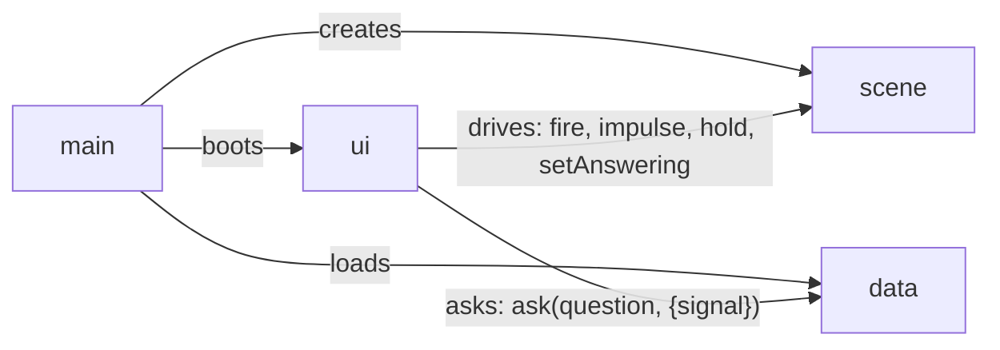

# LLD — zorzo.dev.br (zorzo-site)

2026-11-25 · André de Castro Zorzo · Status: draft

Scope: how the static front is built and how it renders, including the 3D brain. What the system does, the
API contract and how the front behaves against the API live in zorzo-api: `docs/lld.md`, section "8. Client",
"Front against the API", and section "5. Interfaces" ("Stream events", "Published data").

Status labels used below: **existing**, **planned**, **to detail**.

**Where each fact lives**

| Fact | Owner |
| --- | --- |
| Product, architecture, API contract, front behavior | zorzo-api `docs/` |
| Stream contract | zorzo-api `contracts/sse-v1.schema.json` |
| Published data (manifest, corpus, examples) | zorzo-api `docs/lld.md`, "Published data" |
| Rendering, modules, the brain's data | This document |
| Commands and code practices | `AGENTS.md` |

## 1. Stack

| Choice | Why |
| --- | --- |
| Static HTML, CSS and ES modules, no build step and no framework | One page; a bundler would add a toolchain with nothing to bundle. The files are served as they are (S3 in production, `python3 -m http.server` locally) |
| Three.js 0.170.0, vendored in `assets/vendor/three/` | The brain. Served from this site (zorzo-api ADR 0003, single origin): no request to a CDN on page load |
| JetBrains Mono 400 and 500 (latin, latin-ext), vendored in `assets/fonts/` | The only typeface. From `@fontsource/jetbrains-mono` 5.3.0, OFL-1.1 |
| Playwright, through npm, for tests only | Browser tests against recorded data, with no backend (zorzo-api spec F01, seam 2) |

The page loads nothing from another origin. The GitHub repository list in the content section is static.

## 2. Modules

Situation: existing.

```
assets/js/
  main.js        boot: language, intro, published data, then the brain when it can run
  i18n.js        interface text (PT, EN) and the current language
  text.js        question and chunk words (search and token flight share the split)
  util.js        $, accent-free lowercase, seeded random numbers
  scene/         the brain: layout.js (where chunks sit), shaders.js, scene.js (render, picking, impulses)
  ui/            intro.js, hubs.js (labels and cards), ask.js (box, steps, token flight, answer panel)
  data/          published.js (manifest → corpus, examples; entity links), mock.js (the stand-in for the API)
```

**Dependencies between modules**



Allowed imports only; shared helpers (`util.js`, `text.js`, `i18n.js`) are left out.

- The interface may import the scene and the data; the scene and the data never import the interface, and the
  scene never imports the data. The scene receives the chunks and the entities as arguments.
- The interface works when the scene is absent (`scene` is `null`): every brain effect is skipped and the rest
  stays the same (section 4).
- Answers reach the interface only as stream events from `ask(question, {signal})`, an async iterator. Today
  `data/mock.js` produces them; F01-T03 replaces it with the API client without touching the interface.

**The mock.** A BM25 search over the published corpus, with a boost for chunks that name an entity in the
question, emitting what the API emits in search-only mode: `stage` (`guard`, `retrieve`), then `degraded`
and `retrieval` with up to six hits, then `done`. A question shaped like an attempt to override the rules
gets `blocked` and `done`. Situation: existing until F01-T03.

## 3. Brain data

Situation: existing.

`assets/data/brain.json` holds what comes from the mesh; the corpus is placed in the browser, so a new corpus
version reaches the brain with no front build (zorzo-api ADR 0010).

- **brain.json:** `dust` (7,000 surface points, denser on the gyri crests) with `bright` (convexity, 0–1);
  `pools`, per region, crest points in farthest-point order; `hubs`, five fixed points for the navigation
  cards. Coordinates are packed as integers over `q`. Built by `tools/build_brain.py` from the source mesh.
- **Region of a chunk,** from its document kind:

  | Kind | Region |
  | --- | --- |
  | `resume`, `narrative`, `faq` | frontal |
  | `project_doc`, `repo` | temporal |
  | `site_doc` | parietal |
  | `post` | occipital |

- **Position:** a region's k chunks take its first k pool points, which are evenly spread because of the
  farthest-point order. Chunks and points are matched in angular order (chunks by the direction of `p`,
  points around their centre), so chunks close in embedding space sit close on the surface. More chunks than
  pool points reuse the pool, slightly further out.
- **Axons:** each chunk links to its 2 nearest neighbours by `p`, drawn as curves bending toward the centre.
  An impulse travels them breadth first.
- **Entities:** `assets/data/entities.json` (names and types: companies, technologies, concepts, projects) is
  front data. Each entity links to the chunks whose heading or text names it (whole words, ignoring case and
  accents) and sits inside the brain near them. They light up when a question names them and in the "graph"
  step.
- **Effects** (all kept from the prototype): dust with gyri brightness and the circuit-board back half; chunk
  points; entity points; axons; hubs with labels and cards; idle sparks; impulse waves on click and on a
  question; drag, tilt and idle sway; tokens flying from the box to the chunks; citation lines from a passage
  to its chunk; the background glow following the brain.
- **Budget:** 3 draw calls, attributes updated on events only, three quality tiers that drop dust when the
  frame rate falls, drawing paused when the hero is off screen or the tab hidden.

## 4. Without 3D

Situation: existing.

- The brain runs only when WebGL is available and the visitor has not asked for reduced motion. Otherwise the
  still image (`assets/poster.webp`, made by `tools/make_poster.py`) stays, the hub links show as plain links,
  and the question box, the steps panel and the answer panel work the same (F01 PRD, story S11).
- A lost WebGL context brings the still image back.
- If the module never runs (blocked script, old browser), an inline script shows the still image and the plain
  links after 6 s, with their text in the visitor's language.

## 5. Development data and tests

Situation: existing.

- **Production:** the front reads `data/manifest.json` and the folder it names, published by the ingest.
- **Locally:** `data/` is a copy of the API's `DATA_DIR` (git-ignored). Without it, and only on a local host,
  the front reads `demo-data/`: the prototype's corpus (127 chunks of the résumé, the Prosa README, the
  GitHub profile and the first site spec) converted to the published format by
  `tools/convert_mock_corpus.py`, so the brain looks as it does today until the real corpus exists.
  `demo-data/` is never deployed.
- **Tests:** Playwright serves the repository and answers `data/` requests with `tests/fixtures/data/`, the
  published data of zorzo-api's fixture corpus produced by the real ingest with the fake embedder.

## 6. Assets and licenses

- The repository is MIT. `assets/data/brain.json` is CC BY-SA 4.0, derived from "Brain Model" by Nevit
  Dilmen (NIH 3D, 3DPX-003455); the credit shows next to the brain and in `assets/data/LICENSE`.
- The fonts are OFL-1.1 (`assets/fonts/LICENSE`); Three.js is MIT (`assets/vendor/three/LICENSE`).
- The source mesh (43 MB) is not committed: `tools/build_brain.py` says where to download it.

## 7. Open questions

- Deploy (S3 sync excluding `demo-data/`, `tests/`, `tools/`, `node_modules/`, and the `index.html`
  invalidation) is planned with the deploy feature.
