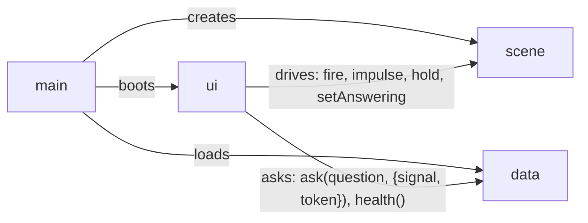

# LLD — zorzo.dev.br (zorzo-site)

2026-11-26 · André de Castro Zorzo · Status: draft

Scope: how the static front is built and how it renders, including the 3D brain. What the system does, the
API contract and how the front behaves against the API live in zorzo-api: `docs/lld.md`, section "8. Client",
"Front against the API", and section "5. Interfaces" ("Stream events", "Published data").

Status labels used below: **existing**, **planned**, **to detail**.

**Where each fact lives**

| Fact | Owner |
| --- | --- |
| Product, architecture, API contract, front behavior | zorzo-api `docs/` |
| Stream contract | zorzo-api `contracts/sse-v1.schema.json` |
| Published data (manifest, corpus, examples) | zorzo-api `docs/lld.md`, "Published data" |
| Rendering, modules, the brain's data | This document |
| Commands and code practices | `AGENTS.md` |

## 1. Stack

| Choice | Why |
| --- | --- |
| Static HTML, CSS and ES modules, no build step and no framework | One page; a bundler would add a toolchain with nothing to bundle. The files are served as they are (S3 in production, `python3 -m http.server` locally) |
| Three.js 0.170.0, vendored in `assets/vendor/three/` | The brain. Served from this site (zorzo-api ADR 0003, single origin): no request to a CDN on page load |
| JetBrains Mono 400 and 500 (latin, latin-ext), vendored in `assets/fonts/` | The only typeface. From `@fontsource/jetbrains-mono` 5.3.0, OFL-1.1 |
| Playwright, through npm, for tests only | Browser tests against recorded data, with no backend (zorzo-api spec F01, seam 2) |
| Cloudflare Turnstile, loaded from `challenges.cloudflare.com` | The bot check every question carries (zorzo-api LLD "Security"). Cloudflare forbids serving the script from anywhere else, so it is the one exception below |

The page loads nothing from another origin except Turnstile's script, and that only on the first interaction with
the question box: a visitor who only browses never contacts Cloudflare. The GitHub repository list in the
content section is static.

## 2. Modules

Situation: existing.

```
assets/js/
  main.js        boot: language, intro, published data, then the brain when it can run
  i18n.js        interface text (PT, EN) and the current language
  text.js        question and chunk words (search and token flight share the split)
  util.js        $, accent-free lowercase, seeded random numbers
  scene/         the brain: layout.js (where chunks sit), shaders.js, scene.js (render, picking, impulses)
  ui/            intro.js, hubs.js (labels and cards), ask.js (box, examples, steps, token flight, answer
                 panel), health.js (online, degraded, offline), turnstile.js (the bot-check token)
  data/          published.js (manifest → corpus, examples; entity links), api.js (the API client)
```

**Dependencies between modules**



Allowed imports only; shared helpers (`util.js`, `text.js`, `i18n.js`) are left out.

- The interface may import the scene and the data; the scene and the data never import the interface, and the
  scene never imports the data. The scene receives the chunks and the entities as arguments.
- The interface works when the scene is absent (`scene` is `null`): every brain effect is skipped and the rest
  stays the same (section 4).
- Answers reach the interface only as stream events from `ask(question, {signal, token})`, an async iterator
  in `data/api.js`.

**The API client.** How the page behaves against the API (health, conversation id, reactions) is in zorzo-api
LLD "Front against the API"; how this code does it:

- Same origin: the paths are `/api/v1/ask` and `/api/healthz`, with no base URL setting (zorzo-api ADR 0003).
- `ask()` sends `POST /api/v1/ask` with `fetch` and reads the body with its own SSE reader: `event:` and
  `data:` lines up to a blank line, `\r\n` or `\n` endings, `: ping` comments skipped, a frame split across
  network chunks reassembled. No library: the format is a few lines.
  Each frame becomes `{kind, ...data}`.
- `ask()` throws `AskError` with a kind the interface turns into a message: the gate's refusals, `invalid`
  (`422`, shown under the box), `bot` (`403`) and `limited` (`429`, with `Retry-After` in seconds, shown as a
  wait in words); `offline` (`502`, `503`, `504` or
  no network; it also sets the page offline), `dropped` (the stream ended before `done`), `failed` (any other status,
  a frame that isn't JSON, or an `error` event, with the trace id of the `done` after it, which the
  interface links). An abort (a new question) throws the browser's `AbortError`, which the interface ignores.
- `ui/health.js` starts on boot, before the data loads; the box subscribes to its state.
- **Bot check:** `ui/turnstile.js` renders Cloudflare's invisible widget in `execute` mode on the first focus,
  key or pointer press on the box or the examples, and fetches a token ahead. Each question takes the token,
  which resets the widget and fetches the next one at once. A `403` gets one more try with a new token; no
  token (script blocked, widget error or timeout) sends nothing and shows the bot-check message. On a local
  host the widget uses Cloudflare's invisible always-pass test key (the same host check that picks
  `demo-data/`); the production site key comes with the deploy, and until then production has no token and the
  gate refuses every question.
- The conversation id is a UUID from `crypto.randomUUID()`, created on the first question and kept in
  `sessionStorage` under `conversation`; with storage blocked, one id per page view.
- Health is checked on load; while offline, again every `HEALTH_POLL_INTERVAL` and when the tab
  regains focus or becomes visible. There is no polling while online.
- A question's outcome is fresher than a health check already in flight. A question that finds the API
  unreachable sets offline at once; one that gets a stream while offline asks for a check (the API answers,
  maybe in search-only mode), and so does one while degraded. Checks never overlap: one requested during
  another runs after it, and when a question's outcome came during a check, that check's result is dropped,
  so the state never goes back to an older one. A health request that hangs past 10 s counts as offline.
- A hit whose chunk isn't in the loaded corpus (a version activated after the page loaded) shows as a
  passage by the title the stream sends, with no text, link or brain point.

**Example questions.** A list under the question box, in the interface language, hidden while an answer is
open; clicking one asks it. While offline every example list is hidden, the answer panel's too. The box, the
intro and the hub links sit above the list by its measured height (`--ex`), which stays reserved while an
answer is open, so nothing moves when one opens. Narrower than 17:20, or under 520 px tall, the list shows
three examples, so the free-tier notice doesn't push the box onto the intro.

**Free-tier notice.** A short paragraph between the box's notices and the example questions, always shown and
linked to the input with `aria-describedby`, and the full text, with the providers named, in the footer
(zorzo-api LLD "Front against the API"). Without JavaScript it is hidden with the box.

## 3. Brain data

Situation: existing.

`assets/data/brain.json` holds what comes from the mesh; the corpus is placed in the browser, so a new corpus
version reaches the brain with no front build (zorzo-api ADR 0010).

- **brain.json:** `dust` (7,000 surface points, denser on the gyri crests) with `bright` (convexity, 0–1);
  `pools`, per region, crest points in farthest-point order; `hubs`, five fixed points for the navigation
  cards. Coordinates are packed as integers over `q`. Built by `tools/build_brain.py` from the source mesh.
- **Region of a chunk,** from its document kind:

  | Kind | Region |
  | --- | --- |
  | `resume`, `narrative`, `faq` | frontal |
  | `project_doc`, `repo` | temporal |
  | `site_doc` | parietal |
  | `post` | occipital |

- **Position:** a region's k chunks take its first k pool points, which are evenly spread because of the
  farthest-point order. Chunks and points are matched in angular order (chunks by the direction of `p`,
  points around their centre), so chunks close in embedding space sit close on the surface. More chunks than
  pool points reuse the pool, slightly further out.
- **Axons:** each chunk links to its 2 nearest neighbours by `p`, drawn as curves bending toward the centre.
  An impulse travels them breadth first.
- **Entities:** `assets/data/entities.json` (names and types: companies, technologies, concepts, projects) is
  front data. Each entity links to the chunks whose heading or text names it (whole words, ignoring case and
  accents) and sits inside the brain near them. They light up when a question names them and in the "graph"
  step.
- **Effects** (all kept from the prototype): dust with gyri brightness and the circuit-board back half; chunk
  points; entity points; axons; hubs with labels and cards; idle sparks; impulse waves on click and on a
  question; drag, tilt and idle sway; tokens flying from the box to the chunks; citation lines from a passage
  to its chunk; the background glow following the brain.
- **Budget:** 3 draw calls, attributes updated on events only, three quality tiers that drop dust when the
  frame rate falls, drawing paused when the hero is off screen or the tab hidden.

## 4. Without 3D

Situation: existing.

- The brain runs only when WebGL is available and the visitor has not asked for reduced motion. Otherwise the
  still image (`assets/poster.webp`, made by `tools/make_poster.py`) stays, the hub links show as plain links,
  and the question box, the steps panel and the answer panel work the same (F01 PRD, story S11).
- Any brain failure (a lost WebGL context, a shader the GPU can't compile, an exception in the frame loop)
  stops the loop, hides the canvas and tells the interface, which continues on the path without 3D.
- If the module never runs (blocked script, old browser), an inline script shows the still image and the plain
  links after 6 s, with their text in the visitor's language.

## 5. Development data and tests

Situation: existing.

- **Production:** the front reads `data/manifest.json` and the folder it names, published by the ingest.
  Without it (before the first publish, or a failed request) the corpus is empty: the brain has no chunk
  points and every question finds no sources, but the page works.
- **Locally:** `tools/serve.py` serves the repository and forwards `/api/*` to the API (`API_URL`, by default
  `http://127.0.0.1:8000`), streaming the response, so the page has one origin as in production. Without the
  API the page is offline; the brain still draws. `data/` is a copy of the API's `DATA_DIR` (git-ignored). When its manifest is missing (404),
  and only on a local host,
  the front reads `demo-data/`: the prototype's corpus (127 chunks of the résumé, the Prosa README, the
  GitHub profile and the first site spec) converted to the published format by
  `tools/convert_mock_corpus.py`, so the brain looks as it does today until the real corpus exists.
  `demo-data/` is never deployed.
- **Tests:** Playwright serves the repository and answers `data/` requests with `tests/fixtures/data/`, the
  published data of zorzo-api's fixture corpus produced by the real ingest with the fake embedder, and
  `/api/` requests by interception: health as each test needs it, Turnstile's script by a stub that hands out a
  new token after each reset (`fixtures.ts`), and the question with a stream from
  `tests/fixtures/streams/`. Those are recorded from the real API in search-only mode over the same database
  (`tools/record_streams.py`), byte for byte, so the hit ids match the fixture corpus; only `error.sse` is
  written by hand, since the API sends `error` only on a bug. Every event of every stream validates against
  the copy of zorzo-api's `contracts/sse-v1.schema.json` next to them (`streams.spec.ts`, with Ajv).

## 6. Assets and licenses

- The repository is MIT. `assets/data/brain.json` is CC BY-SA 4.0, derived from "Brain Model" by Nevit
  Dilmen (NIH 3D, 3DPX-003455); the credit shows next to the brain and in `assets/data/LICENSE`.
- The fonts are OFL-1.1 (`assets/fonts/LICENSE`); Three.js is MIT (`assets/vendor/three/LICENSE`).
- The source mesh (43 MB) is not committed: `tools/build_brain.py` says where to download it.

## 7. Open questions

- Deploy (S3 sync excluding `demo-data/`, `tests/`, `tools/`, `node_modules/`, and the `index.html`
  invalidation) is planned with the deploy feature. The modules have no version in their names, so the deploy
  must keep a visitor from mixing old and new modules (no-cache on `assets/js/`, or versioned paths): a
  decision for that feature.
